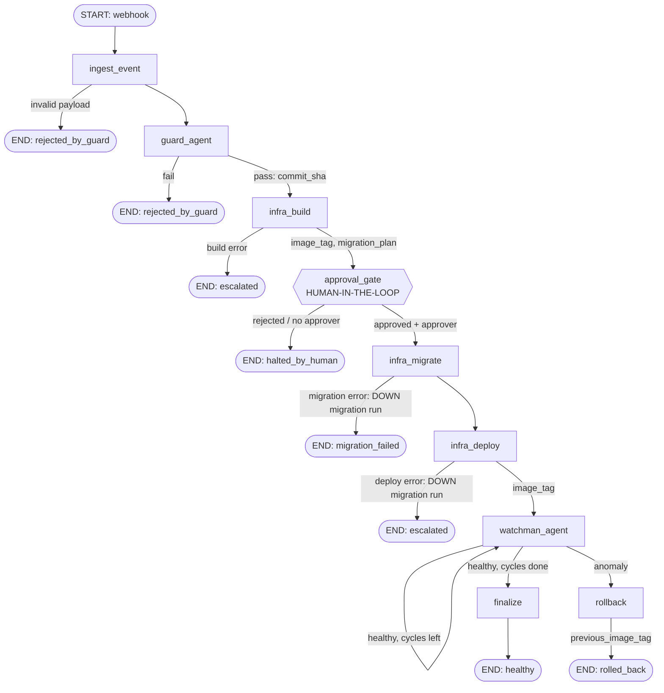

# 02 — Event-Driven Agentic Pipeline Blueprint

Implementation: [`pipeline/`](../pipeline) (LangGraph `StateGraph`). Run with `python -m pipeline <scenario>`.

## 1. Manual baseline vs. agentic pipeline

| Manual step (see [01](01-manual-baseline.md)) | Agentic replacement | Owner | Trigger |
|---|---|---|---|
| M1 notice merge | `ingest_event` validates webhook payload | Pipeline | Push/merge webhook |
| M2 run tests | `run_test_suite` tool | **Guard-Agent** | Valid event |
| M3 read log, decide | Deterministic parser + LLM verdict (LLM can veto, never approve over failing evidence) | **Guard-Agent** | Test run finished |
| M4 build image | `build_image` tool | **Infra-Agent** | `build_verdict == "pass"` |
| M5 review migration | `preview_migration` + risk summary shown at gate | **Infra-Agent** + human | Image built |
| M5/M6 approve + migrate | `approval_gate` (`interrupt`) → `apply_migration` | **Human gate**, Infra-Agent | Signed approval |
| M7 deploy | `deploy_container` tool | **Infra-Agent** | Migration OK |
| M8 watch | `fetch_runtime_metrics` sampled in a bounded loop | **Watchman-Agent** | Deploy OK |
| M9 rollback | `rollback_deployment` | **Watchman-Agent** | Threshold breach |

## 2. State machine

The only cycle is `watchman_agent → watchman_agent`, capped by `Guardrails.max_watch_cycles`. Rollback is **terminal**; it never re-enters the Infra-Agent (see the correction log for why).

## 3. State handoffs (data shifts from state to state)

| From → To | State keys passed | Notes |
|---|---|---|
| Webhook → `ingest_event` | `event` | Rejected if no ≥7-char commit hash |
| `ingest_event` → Guard | `commit_sha`, `branch` | Single source of truth for the commit |
| Guard → Infra | `commit_sha`, `build_verdict="pass"`, `test_summary` | Infra only runs on `pass` (router `route_after_guard`) |
| Infra build → Gate | `image_tag`, `previous_image_tag`, `migration_id`, `migration_plan` | Gate shows these to the human; `previous_image_tag` is captured **before** deploy |
| Gate → Infra migrate | `approval`, `approver` | `infra_migrate` asserts `approval == "approved"` (defence in depth) |
| Infra deploy → Watchman | `image_tag`, `deploy_status="ok"` | Starts the observation window |
| Watchman → Rollback | `previous_image_tag`, `anomaly_reason` | Rollback target never recomputed |
| Every node → audit | `audit` (append-only reducer) | One entry per action; includes approver identity |

## 4. Agent responsibilities and tool binding (least privilege)

| Agent | Tools bound | Cannot do |
|---|---|---|
| Guard-Agent | `run_test_suite` | Build, migrate, deploy |
| Infra-Agent | `build_image`, `preview_migration`, `apply_migration`, `revert_migration`, `deploy_container` | Approve its own migration; read metrics |
| Watchman-Agent | `fetch_runtime_metrics`, `rollback_deployment` | Build or migrate |

## 5. Stateful guardrails

| Risk | Guardrail | Where |
|---|---|---|
| Untested code reaches production | Router sends only `build_verdict == "pass"` to Infra | `route_after_guard` |
| LLM misreads a failing log as passing | Hard evidence (exit code, failed count) overrides the LLM | `guard_agent` |
| Migration runs unreviewed | `interrupt()` pause; resume needs `approval="approved"` **and** a named approver; node asserts approval | `approval_gate`, `infra_migrate` |
| Bad migration | DOWN migration executed immediately; deploy skipped | `infra_migrate` |
| Failed deploy leaves schema ahead of app | DOWN migration executed, run escalated | `infra_deploy` |
| Post-release regression | 5xx rate / p95 thresholds over bounded samples, ignoring low-traffic samples | `watchman_agent` |
| Infinite loops / rollback ping-pong | Rollback terminal, `max_rollbacks=1`, bounded watch loop, `recursion_limit=40` | `graph.py` |
| Arbitrary command execution | Binary allowlist in `ShellRunner` (exit 126 when blocked) | `tools.py` |
| Pause loses progress | Checkpointer persists state at the gate (`MemorySaver`; swap for Postgres/SQLite in production) | `build_graph` |

**Design decision — schema on rollback.** A watchman rollback restores the previous *image* only. The migration is left in place (expand/contract style: additive migrations stay backward compatible); destructive migrations should be handled by a human, which is why the gate prints a `DESTRUCTIVE`/`ADDITIVE` label.

## 6. Verification

`pytest` (9 tests) covers: happy path, failed tests never reach Infra, pause-before-migrate, rejection, approval without approver, migration failure revert, single rollback on error spike, invalid webhook, and the command allowlist. Demo scenarios: `happy`, `tests_fail`, `rejected`, `migration_fail`, `spike`.
